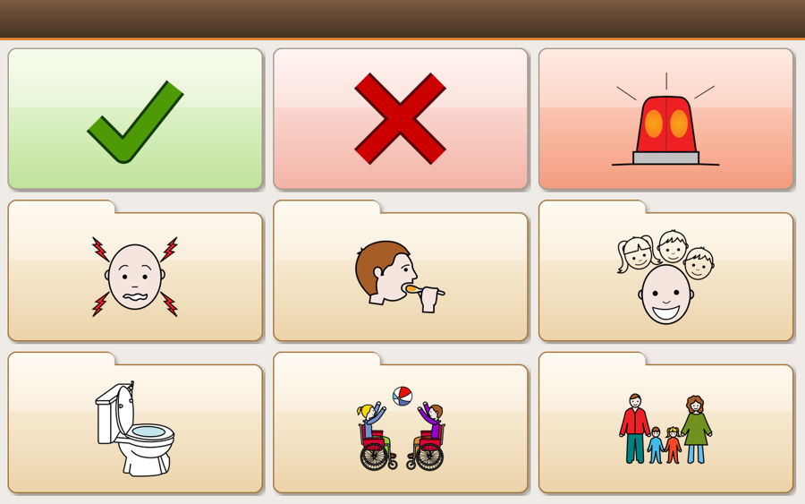
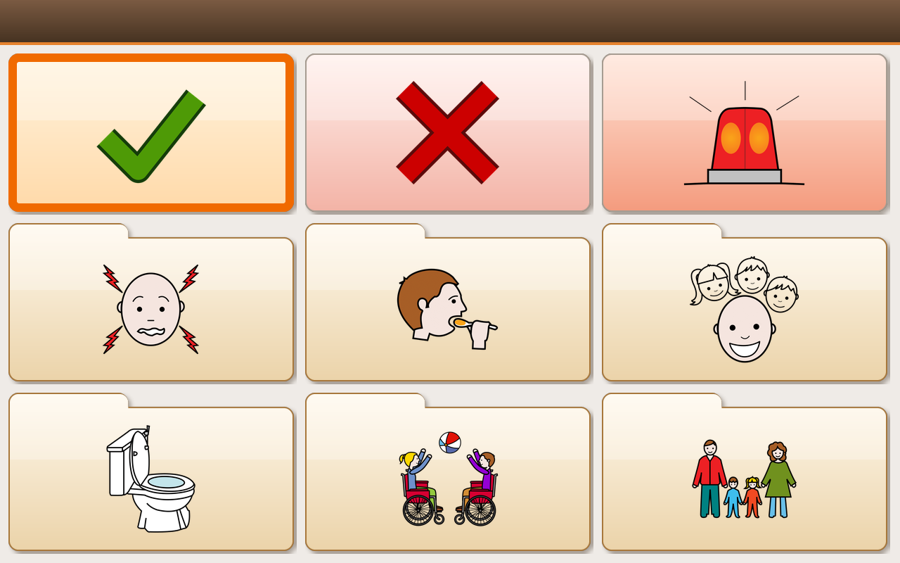
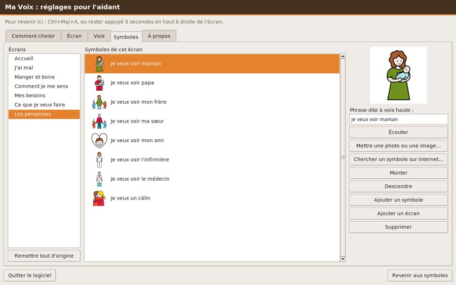
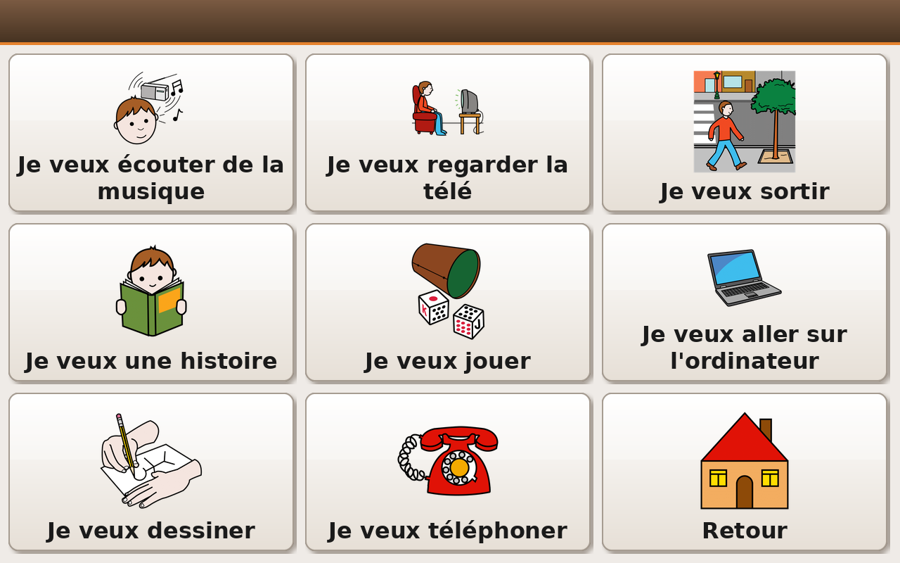

# Ma Voix

**Parler avec des symboles, sans lire ni écrire.**

Ma Voix est fait pour une personne en situation de handicap mental et physique, qui ne peut ni parler ni écrire.
De base, l'écran ne montre aucun mot, seulement de grands symboles. Un choix, et la phrase est dite à voix haute.

### [⬇ Télécharger Ma Voix (.deb, 67 Mo)](https://github.com/jbandrivet/ma-voix/releases/latest/download/ma-voix_amd64.deb)

Pour Ubuntu ou Debian sur un PC 64 bits. Voir [comment l'installer](#installer).



## Ce que fait le logiciel

- **Aucun mot à l'écran** pour la personne, en plein écran, dans le style d'Ubuntu 2008. L'aidant peut quand même faire écrire les phrases sous les symboles.
- **Un choix = une phrase.** Le symbole s'affiche en très grand pendant qu'il est dit, pour que l'entourage le voie aussi.
- **Oui, Non et une alarme d'aide** sur l'accueil. L'alarme sonne jusqu'à ce qu'on appuie sur la maison. Puis six dossiers : mal, manger et boire, émotions, besoins, activités, personnes.
- **Une voix de femme naturelle, ralentie**, qui marche sans internet. Une voix de robot est aussi disponible.

### Quatre façons de choisir

1. En touchant ou en cliquant sur le symbole. Le tactile marche aussi sous GNOME avec Wayland, où les logiciels Tk ne reçoivent normalement pas l'appui du doigt.
2. En restant sur le symbole, sans cliquer (souris à la tête, regard).
3. Avec **un seul contact** : le cadre orange défile tout seul.
4. Avec deux contacts : un pour avancer, un pour choisir.



### Pour l'aidant

Les réglages s'ouvrent au premier lancement. Ensuite : **Ctrl+Maj+A**, ou rester appuyé 5 secondes en haut à droite de l'écran.

L'aidant peut changer les phrases, supprimer ce qui ne convient pas, mettre de vraies photos de la famille,
chercher d'autres symboles sur internet, choisir 4, 6, 9 ou 12 symboles par écran, faire écrire les phrases,
et régler le masculin ou le féminin.





## Installer

1. [Téléchargez le fichier](https://github.com/jbandrivet/ma-voix/releases/latest/download/ma-voix_amd64.deb).
2. Double-cliquez dessus, puis choisissez **Installer** et entrez votre mot de passe.
3. Ma Voix apparaît dans le menu des applications.

Tout ce dont le logiciel a besoin s'installe tout seul, si l'ordinateur est relié à internet.

Si le double-clic ne fonctionne pas, ouvrez un terminal et collez :

```
cd ~/Téléchargements && sudo apt install ./ma-voix_amd64.deb
```

Sur Ubuntu 24.04 et les systèmes plus anciens, le paquet `python3-onnxruntime` n'existe pas : les phrases d'origine gardent
la voix naturelle, mais les phrases ajoutées auront la voix de robot.

Les mises à jour se font ensuite depuis les réglages de l'aidant : quand une nouvelle version existe, un bouton orange
**Mettre à jour** apparaît en bas. Le mot de passe administrateur est demandé. Ma Voix ne contacte GitHub qu'à
l'ouverture des réglages, et n'envoie aucune donnée sur la personne.

## Fabriquer le paquet

```
sh packaging/make-deb.sh
```

Le script télécharge la voix (63 Mo) si elle manque. Si vous changez les phrases d'origine ou la lenteur de départ,
refaites d'abord les enregistrements : `python3 ma_voix.py --preparer-sons sons` (il faut `python3-onnxruntime`).

## Licences

Toutes les parties de ce dépôt n'ont pas la même licence.

| Partie | Licence |
|---|---|
| Programme | [GPL version 3 ou suivante](LICENSE) |
| Piper, dans `piper/` | [GPL version 3 ou suivante](piper/LISEZMOI.md) |
| Voix Siwis et phrases enregistrées | [CC BY 4.0](sons/LICENCE.md) |
| Symboles ARASAAC, dans `symboles/`, et les captures de `docs/` | [CC BY-NC-SA 4.0](symboles/LICENCE.md), **usage non commercial uniquement** |

Le programme est libre. **Les symboles ne peuvent pas être utilisés pour un produit vendu** : pour cela, il faudrait les remplacer.

Pictogrammes : Sergio Palao. Origine : [ARASAAC](https://arasaac.org). Licence : CC BY-NC-SA. Propriété : Gouvernement d'Aragon (Espagne).

## Important

Ma Voix aide à communiquer. Ce n'est pas un appareil médical, et il ne remplace ni une sonnette d'appel ni une surveillance :
si le son de l'ordinateur est coupé ou si l'ordinateur est éteint, personne n'entend l'alarme.

Le défilement à un seul contact s'inspire d'ACAT, le logiciel libre d'Intel fait pour Stephen Hawking.
Ma Voix n'en contient aucun code et n'est ni lié à Intel ni approuvé par Intel.
